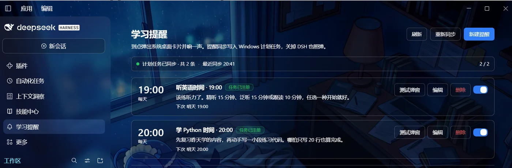
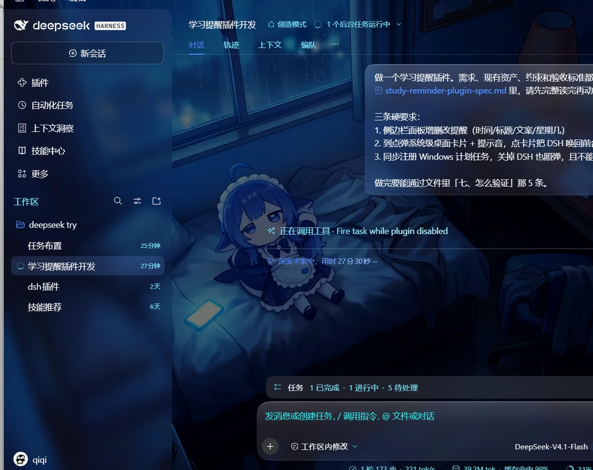

# 学习提醒 · dsh-study-reminder

DSH 桌面端的本地 bundle：在侧边栏管理学习提醒，到点弹出 **Windows 系统级桌面卡片 + 提示音**，并把每条提醒同步注册成 **Windows 计划任务**。关掉 DSH（甚至停用插件）后，计划任务仍会照常弹卡。

不会向对话里发消息，也没有注册任何 agent tool；不访问网络。

## 界面

| 侧边栏面板 | 到点弹出的系统级卡片 |
| --- | --- |
|  |  |

停用插件后，侧边栏里不再有「学习提醒」入口，但计划任务照常弹卡（就是上面那张）：



## 安装

要求：Windows + DSH 桌面端。插件没有依赖，也不需要 pnpm 或构建步骤。

1. 下载本仓库（`git clone`，或在 Releases 下载 zip 后解压）
2. 打开 DSH → **Plugins / 插件** → **Add plugin / 添加插件** → 选中插件目录（含 `package.json` 的那一层）
3. 新开一个会话，侧边栏出现 **学习提醒** 即安装成功

命令行也可以：`dsh plugin add <插件目录>`，profile 用你正在用的那个。

## 它会动系统哪些地方

装之前请知悉，这个插件不是纯装饰：

- **创建 Windows 计划任务**，名字形如 `DSH Study Reminder - <id>`，动作指向本目录下的 `scripts/Popup-Reminder.ps1`
- 通过 **PowerShell** 弹卡片、聚焦 DSH 窗口；保存提醒时调用 `Register-ScheduledTask`
- 删除提醒会一并删除对应计划任务；**停用插件不会删任务**（这正是「关了也弹」的前提）
- 不联网、不上报、无遥测：全仓库唯一的 `http://` 是 `icon.svg` 里的 SVG 命名空间

## 使用

侧边栏 → **学习提醒**：

- **新建提醒**：时间（HH:MM）、标题、文案、星期几（可一键「每天 / 工作日」）、启用开关。
- **编辑**：点行内「编辑」，表单会回填当前值，改完保存。
- **删除**：点「删除」并确认；对应的 Windows 计划任务会一起移除。
- **测试弹窗**：立即弹一张卡片，不影响计划任务。同一时间只保留一张测试卡片（同一 id 互斥）；卡片还在时重复点击不会叠加，等它消失或点掉再试。
- **重新同步**：数据与计划任务出现偏差时手动对账。

保存后提醒写入数据文件，并同步 `Register-ScheduledTask`。保存按钮会等待同步完成（本机 Task Scheduler CIM 约 3–6 秒）。卡片会在设定时间出现，默认 30 秒后自动消失；点一下立即关闭并把 DSH 唤回前台。

## 数据与实现

| 内容 | 位置 |
| --- | --- |
| 提醒数据 | `C:\Users\<user>\.dsh\study-reminder\reminders.json` |
| 单条弹窗配置 | `...\study-reminder\configs\<id>.json` |
| 运行信息（URL / exe） | `...\study-reminder\runtime.json` |
| 弹窗日志 | `...\study-reminder\logs\popup.log` |
| 测试弹窗诊断日志 | `...\study-reminder\logs\test-popup.log` |
| 计划任务名 | `DSH Study Reminder - <id>` |

- Host 半（`index.js`）是唯一的数据写入者，注册 5 个同源路由：`state` / `save` / `delete` / `sync` / `test`。
- Client 半（`client.js`）注册 `sidebar.panellist` 的 `study-reminder` 入口和 `main` 的同名面板。
- `scripts/Sync-Reminders.ps1` 做对账：只对 action / 触发时间 / 星期 / 启用状态变化的提醒重新注册；删除过期任务与配置；首次接管旧的 `DSH Reminder - *` 任务。
- `scripts/Popup-Reminder.ps1` 是复用并扩展过的弹窗脚本：Per-Monitor-V2 DPI、`WS_EX_NOACTIVATE`、工作区裁剪、点击关闭、`SystemSounds` 提示音，并新增点击后调用聚焦脚本；脚本显式隐藏 PowerShell 控制台，并用命名互斥量保证同一 id 只有一张卡片。
- 测试弹窗由 Host 以「附着子进程 + 文件型 stdio」启动，不把子进程 detach 出去（detach 的进程会被桌面 shell 的 job 对象提前结束），stdout/stderr 写入 `logs/test-popup.log` 便于排查。
- `scripts/Focus-DSH.ps1` 先找 `Chrome_WidgetWin_1` 主窗口（含隐藏/最小化），`ShowWindow` + `SetForegroundWindow`；找不到窗口时启动 `DeepSeek Harness.exe`，再退回打开记录的 DSH URL。
- 防重复：固定任务名 + `Register-ScheduledTask -Force` + `MultipleInstances IgnoreNew` + 弹窗互斥量 + 旧任务接管后删除。

首次启用时，会把已有的 `DSH Reminder - Listen English`、`DSH Reminder - Learn Python` 读成插件数据（时间、标题、文案、星期），然后删除旧任务，避免两份任务各弹一次。

## 排障

- **点「测试弹窗」没反应**：先看 `logs/test-popup.log`。正常应看到 `spawn pid=...`；随后 `logs/popup.log` 应出现 `show id=test` / `shown id=test`。若测试卡片还开着，重复点击会被同 id 互斥量忽略（每张卡片默认 20–30 秒）。
- 若 `test-popup.log` 只有 `exit code=0` 没有 `show`，说明子进程在创建窗口前退出；在 Plugin Manager 里对 `dsh-study-reminder` 关闭再启用（或重启 DSH）后重试。
- **计划任务没弹**：`Get-ScheduledTask -TaskName 'DSH Study Reminder*'` 看 State；`logs/popup.log` 看是否有对应 id 的 `show`。若插件目录被移动，任务里的脚本路径会失效，需要重新同步。
- **中文乱码**：确认提醒数据是 UTF-8；不要用 GBK 终端直接给接口 POST 中文（面板输入不受影响）。

## 验证结果（2026-11-04）

| 验收项 | 结果 |
| --- | --- |
| 面板新建「20:54 背单词」 | 面板保存成功；20:54:02 计划任务自动触发卡片，中文标题/文案正常 |
| `Get-ScheduledTask -TaskName 'DSH Study Reminder*'` | 仅 2 个任务：`listen-english` 19:00、`learn-python` 20:00，状态 `Ready` |
| 停用插件后触发任务 | 插件路由 404、侧边栏入口消失，`Start-ScheduledTask` 仍弹卡片；证明弹窗不依赖 DSH/插件进程 |
| 重新启用插件 | 数据 2 条、任务 2 个，`lastSync.ok = true`，无重复任务 |
| 连续启动同一任务两次 | 只有 1 个弹窗进程、1 条 `show/shown` 日志 |
| 点卡片 | `popup.log` 记录 `click-focus`，聚焦脚本返回 `FOCUSED=1`，DSH 窗口回到前台 |
| 测试弹窗 | 修复 Host 的 detached 子进程问题后，`/test` 正常产生 `spawn` → `show` → `shown`；面板按钮调用同一个 `api('test')` |

截图见 [docs/](docs/)：`panel.webp`（面板）、`popup-card.webp`（卡片）、`popup-disabled.webp`（停用插件后仍弹）。

提示音由 `SystemSounds.Asterisk.Play()` 在卡片 `Shown` 时播放；自动化无法录音确认音量，但执行路径无异常。

## 已知限制

- 仅 Windows；计划任务按当前用户注册，需要用户已登录（注销后不弹）。
- **不要移动或删除插件目录**：计划任务的动作直接引用本目录下的 `scripts\Popup-Reminder.ps1`（安装时记下的绝对路径）。DSH 以链接方式安装本地目录，移动后需要重新安装并点一次「重新同步」。
- 停用插件不会删除计划任务（这是「关了也弹」的前提）；若确实要彻底卸载，请先删除面板里的提醒，或手动删除 `DSH Study Reminder - *` 任务。
- Task Scheduler 的触发有约 1–2 秒延迟，属系统行为。
- 保存/删除会等待一次完整对账，本机约 3–6 秒；期间面板按钮禁用。
- 「完全退出 DSH 也弹」由计划任务保证；此时点卡片会尝试启动 `DeepSeek Harness.exe` 并聚焦窗口，若桌面端不可用则打开 `runtime.json` 里记录的 DSH URL。
- 面板视图在 DSH 收到新会话活动时可能被切回对话，这是 DSH 的导航行为；再次点侧边栏「学习提醒」即可。
- 本插件不修改 DSH 核心，也不提供对话内工具/消息。

## 文件

```text
study-reminder-plugin/
├─ package.json
├─ cordis.patch.yml
├─ index.js               # Host：数据、HTTP 路由、PS 调用
├─ client.js              # Client：侧边栏入口 + 面板
├─ locale/{zh,en}.json    # Plugin Manager 标题/描述
├─ icon.svg
├─ LICENSE                # MIT
├─ docs/                  # README 截图（WebP）
└─ scripts/
   ├─ Popup-Reminder.ps1  # 桌面卡片（点击聚焦、提示音、DPI、互斥）
   ├─ Focus-DSH.ps1       # 聚焦 / 启动 DSH
   ├─ Sync-Reminders.ps1  # 计划任务对账
   └─ Migrate-Legacy.ps1  # 接管旧 DSH Reminder 任务
```

## 许可证

[MIT](LICENSE)
